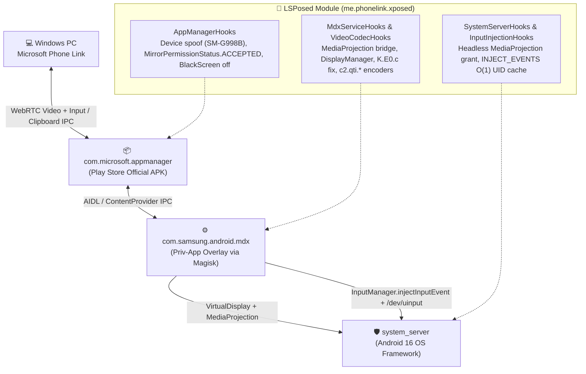

<div align="center">

# 📱 Phone Link AOSP Port (Magisk + LSPosed)

**Enable Microsoft Phone Link (*Link to Windows*) Phone Screen mirroring, low-latency hardware video streaming, and remote input on rooted AOSP Android 16 devices.**

[](README.md)
[](README.ru.md)

[-3DDC84?style=flat-square&logo=android&logoColor=white)](#compatibility)
[-FF6900?style=flat-square&logo=xiaomi&logoColor=white)](#compatibility)
[](#compatibility)
[](#architecture)
[](#automated-testing)
[](#building-from-source)

</div>

---

## ✨ Overview

This project unlocks Samsung-exclusive **Microsoft Link to Windows** (`com.microsoft.appmanager`) features — including **Phone Screen mirroring**, **auto-granted `MediaProjection`**, **two-way mouse/keyboard control**, and **AOSP compatibility fixes** — on non-Samsung AOSP ROMs without modifying vendor firmware.

> [!NOTE]
> Developed and verified on **Xiaomi Mi 9 (`cepheus`)** running **AOSP Project Infinity X (Android 16 / SDK 36)**. Other rooted AOSP devices with Qualcomm SoCs on Android 16 can also work, though system/codec hooks may need tuning for other Android versions or SoC vendors (MediaTek, Exynos, Tensor).

---

## 🏗️ Architecture



### Key Components

| Layer | Responsibility | Source |
| :--- | :--- | :--- |
| **App Spoofing & Permissions** | Scopes `Build.MANUFACTURER = "samsung"` (`SM-G998B`) to target packages, stubs `SemFloatingFeature`, auto-accepts `MirrorPermissionStatus.ACCEPTED`, disables `BlackScreen` capability | [`AppManagerHooks.java`](lsposed_module/app/src/main/java/me/phonelink/xposed/hooks/AppManagerHooks.java) |
| **MDX Service Bridge** | Bridges `W0.t.createVirtualDisplay` & `W0.p` `MediaProjection`, stubs `SemWindowManager` / `RemoteAppModeManager`, suppresses incompatible One UI `BlackScreen` & `.spr` battery drawables | [`MdxServiceHooks.java`](lsposed_module/app/src/main/java/me/phonelink/xposed/hooks/MdxServiceHooks.java) |
| **System Server Bypass** | Auto-grants `MediaProjection` tokens headlessly and caches privileged UIDs in `O(1)` for `INJECT_EVENTS` | [`SystemServerHooks.java`](lsposed_module/app/src/main/java/me/phonelink/xposed/hooks/SystemServerHooks.java) |
| **Input & Codec Pipelines** | Maps `SemInputInjector` to AOSP `InputManager`, handles right-click **Back** & middle-click **Home**, redirects encoders to Qualcomm `c2.qti.*` | [`InputInjectionHooks.java`](lsposed_module/app/src/main/java/me/phonelink/xposed/hooks/InputInjectionHooks.java), [`VideoCodecHooks.java`](lsposed_module/app/src/main/java/me/phonelink/xposed/hooks/VideoCodecHooks.java) |
| **Magisk Overlay** | Installs `LinkToWindowsService` into `/system/priv-app/`, grants priv-app & Doze permissions, configures `/dev/uinput` & SELinux policies | [`magisk_module/`](magisk_module/) |

---

## 📋 Compatibility & Prerequisites

- **OS Version**: Android 16 (SDK 36) AOSP / custom ROM *(tested on Project Infinity X)*
- **Root**: Magisk v26.0+ or KernelSU / APatch with **Zygisk** enabled
- **Xposed Framework**: **LSPosed** (Zygisk v1.9.2+ / Zygisk Next fork)
- **Hardware**: Tested on **Qualcomm Snapdragon 855** (`c2.qti.avc.encoder` / `c2.qti.hevc.encoder`)
- **Apps**:
  - Android: **Microsoft Link to Windows** (`com.microsoft.appmanager`) from Google Play
  - PC: **Phone Link** («Связь с телефоном») on Windows 10 / 11

> [!IMPORTANT]
> Proprietary APKs (`LinkToWindowsService.apk`, `com.microsoft.appmanager`) are excluded from this repository via `.gitignore`. Place `LinkToWindowsService.apk` into `magisk_module/system/priv-app/LinkToWindowsService/` before building the Magisk zip, or download prebuilt releases if provided under **Releases**.

---

## 🚀 Installation

1. **Remove conflicting user-installed MDX (if any):**
   ```bash
   adb shell pm uninstall com.samsung.android.mdx
   ```
2. **Flash the Magisk Module:**
   - Transfer `PhoneLinkMagisk-v2.0.0.zip` to your device and install it in **Magisk / KernelSU Manager → Modules → Install from storage**.
   - **Do not reboot yet.**
3. **Install & Enable the LSPosed Module:**
   ```bash
   adb install -r PhoneLinkXposed.apk
   ```
   Open **LSPosed Manager → Modules → Phone Link Port (`me.phonelink.xposed`)**, enable it, and check **all 3 scopes**:
   - [x] **System Framework** (`android`)
   - [x] **Link to Windows** (`com.microsoft.appmanager`)
   - [x] **Link to Windows Service** (`com.samsung.android.mdx`)
4. **Reboot your phone** and pair your PC via **Link to Windows** (`com.microsoft.appmanager`).

---

## 🖱️ PC Controls

| PC Input | Android Action | Mechanism |
| :--- | :--- | :--- |
| **Left Click / Drag** | Tap / Swipe / Scroll | AOSP `InputManager.injectInputEvent` with target display ID |
| **Right Click** | **Back** (`KEYCODE_BACK`) | Stateful button tracking in `InputInjectionHooks` |
| **Middle Click** | **Home** (`KEYCODE_HOME`) | Stateful button tracking in `InputInjectionHooks` |
| **Keyboard Typing** | Direct Text / Navigation | Hardware bridge via `/dev/uinput` (`0666`) |
| **Ctrl + C / Ctrl + V** | Clipboard Sync | Two-way clipboard bridge |

---

## 🛠️ Troubleshooting

<details>
<summary><b>View diagnostics commands & common fixes</b></summary>

- **Check boot daemon log:**
  ```bash
  adb shell su -c "cat /data/local/tmp/phonelink_service.log"
  ```
- **Live hook logcat filter:**
  ```bash
  adb logcat -s PhoneLinkInit PhoneLink-SystemServerHooks PhoneLink-InputInjectionHooks PhoneLink-VideoCodec PhoneLink-MdxService PhoneLink-AppManager
  ```
- **Verify `/dev/uinput` permissions:**
  ```bash
  adb shell ls -la /dev/uinput /dev/uhid
  ```
- **"Phone Screen" missing or prompts repeatedly:** Verify all 3 scopes (`android`, `com.microsoft.appmanager`, `com.samsung.android.mdx`) are enabled in LSPosed and reboot.
- **No video / encoder issue on non-Qualcomm SoC:** Adjust hardware encoder names in [`VideoCodecHooks.java`](lsposed_module/app/src/main/java/me/phonelink/xposed/hooks/VideoCodecHooks.java).

</details>

---

## 🧪 Automated Testing

The repository includes an opaque-box E2E test suite (**349 tests across 5 tiers** + compiled Java bytecode stress tests):

```bash
# Run full E2E suite
python tests/test_runner.py

# Run individual tiers
python tests/test_runner.py --tier 1   # Feature Coverage (74 tests)
python tests/test_runner.py --tier 2   # Boundary & Corner Cases (184 tests)
python tests/test_runner.py --tier 3   # Cross-Feature Combinations (14 tests)
python tests/test_runner.py --tier 4   # Real-World Scenarios (8 tests)
python tests/test_runner.py --tier 5   # Adversarial Stress & Java Bytecode (69 tests)
```

---

## 🔨 Building from Source

Requires **Python 3.10+** and **JDK 17+** (`build_lsposed.py` fetches required Android/Xposed build tools automatically if absent).

```bash
# Build both Magisk ZIP & LSPosed APK + SHA256SUMS.txt
python build.py

# Build & run full test suite
python build.py --test

# Build LSPosed APK standalone
python lsposed_module/build_lsposed.py
```

Outputs are placed in `build/` (`PhoneLinkMagisk-v2.0.0.zip`, `PhoneLinkXposed.apk`, `SHA256SUMS.txt`).
