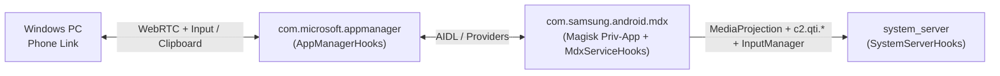

<div align="center">

# 📱 Phone Link AOSP Port

**Full Samsung-tier *Link to Windows* features on rooted AOSP Android 16.**

[](README.md)
[](README.ru.md)

[](https://github.com/Fleshoo/phonelink-aosp-module/releases/latest)
[-3ddc84?style=flat-square&logo=android&logoColor=white)](#requirements)
[-ff6900?style=flat-square&logo=xiaomi&logoColor=white)](#requirements)
[](#build--tests)

[**Download Latest Release**](https://github.com/Fleshoo/phonelink-aosp-module/releases/latest)

</div>

---

## What It Does

- **Phone Screen Mirroring** — Streams Android screen to Windows PC without One UI firmware or repeating `MediaProjection` prompts.
- **Hardware Encoding** — Redirects Samsung encoder lookups to Qualcomm `c2.qti.avc.encoder` / `c2.qti.hevc.encoder` with instant IDR sync frames.
- **Remote Input & Clipboard** — Translates PC mouse, keyboard (`/dev/uinput`), navigation clicks, and clipboard sync.
- **AOSP Stability** — Suppresses incompatible One UI `BlackScreen` overlays/`.spr` assets and prevents MDX teardown crashes when stopping mirroring from the phone.

> [!NOTE]
> Tested on **Xiaomi Mi 9 (`cepheus`)** running **Project Infinity X (Android 16 / SDK 36)**. Other rooted Android 16 AOSP devices on Qualcomm SoCs can work too; other Android versions or SoCs (MediaTek/Exynos/Tensor) may require hook/codec adjustments.

---

## Requirements

- **OS:** Android 16 (SDK 36) AOSP custom ROM
- **Root + Hooks:** Magisk v26+ (or KernelSU / APatch with Zygisk) + **LSPosed**
- **Apps:** **Microsoft Link to Windows** (`com.microsoft.appmanager`) on Android + **Phone Link** on Windows 10/11

---

## Installation

1. **Remove any user-installed MDX (if present):**
   ```bash
   adb shell pm uninstall com.samsung.android.mdx
   ```
2. **Download [`PhoneLinkMagisk-v2.1.0.zip`](https://github.com/Fleshoo/phonelink-aosp-module/releases/latest) and [`PhoneLinkXposed.apk`](https://github.com/Fleshoo/phonelink-aosp-module/releases/latest) from Releases.**
3. **Flash `PhoneLinkMagisk-v2.1.0.zip`** in Magisk / KernelSU Manager (*Modules → Install from storage*). Do not reboot yet.
4. **Install `PhoneLinkXposed.apk`** (`adb install -r PhoneLinkXposed.apk`), open **LSPosed Manager → Modules → Phone Link Port**, enable it, and check **all 3 scopes**:
   - `android` (System Framework)
   - `com.microsoft.appmanager` (Link to Windows)
   - `com.samsung.android.mdx` (Link to Windows Service)
5. **Reboot** and pair your PC in **Link to Windows**.

---

## PC Controls

| Input on PC | Action on Android |
| :--- | :--- |
| **Left Click / Drag / Scroll** | Tap / Swipe / Scroll on virtual display |
| **Right Click** | **Back** (`KEYCODE_BACK`) |
| **Middle Click** | **Home** (`KEYCODE_HOME`) |
| **Keyboard / Ctrl+C, Ctrl+V** | Hardware text input (`/dev/uinput`) & clipboard sync |

---

## Architecture



<details>
<summary><b>Source Modules, Troubleshooting & Build / Tests</b></summary>

### Modules
- [`AppManagerHooks.java`](lsposed_module/app/src/main/java/me/phonelink/xposed/hooks/AppManagerHooks.java) — `SM-G998B` spoofing, `SemFloatingFeature` stubs, auto-accepted permissions, `BlackScreen` disabled
- [`MdxServiceHooks.java`](lsposed_module/app/src/main/java/me/phonelink/xposed/hooks/MdxServiceHooks.java) — `VirtualDisplay` / `MediaProjection` bridge, `WindowContext` / `.spr` fixes, safe `AppExecutionContainerService` teardown
- [`SystemServerHooks.java`](lsposed_module/app/src/main/java/me/phonelink/xposed/hooks/SystemServerHooks.java) — Headless `MediaProjection` grant & `O(1)` `INJECT_EVENTS` UID cache
- [`InputInjectionHooks.java`](lsposed_module/app/src/main/java/me/phonelink/xposed/hooks/InputInjectionHooks.java) & [`VideoCodecHooks.java`](lsposed_module/app/src/main/java/me/phonelink/xposed/hooks/VideoCodecHooks.java) — Display-targeted input, Back/Home chords, `c2.qti.*` encoder mapping
- [`magisk_module/`](magisk_module/) — `/system/priv-app/LinkToWindowsService` overlay, XML allowlists, `/dev/uinput` permissions

### Troubleshooting
- **Boot log:** `adb shell su -c "cat /data/local/tmp/phonelink_service.log"`
- **Hook logs:** `adb logcat -s PhoneLinkInit PhoneLink-SystemServerHooks PhoneLink-InputInjectionHooks PhoneLink-VideoCodec PhoneLink-MdxService PhoneLink-AppManager`
- **No screen mirroring / permission loop:** Check all 3 LSPosed scopes (`android`, `com.microsoft.appmanager`, `com.samsung.android.mdx`) and reboot.
- **No video on non-Qualcomm SoC:** Update encoder names in [`VideoCodecHooks.java`](lsposed_module/app/src/main/java/me/phonelink/xposed/hooks/VideoCodecHooks.java).

### Build & Tests
Requires **Python 3.10+** and **JDK 17+**. Place `LinkToWindowsService.apk` into `magisk_module/system/priv-app/LinkToWindowsService/` before building the Magisk ZIP.

```bash
python build.py --test                # Build Magisk ZIP + LSPosed APK + SHA256SUMS.txt & run 349 tests
python lsposed_module/build_lsposed.py  # Build LSPosed APK only
python tests/test_runner.py             # Run E2E test suite (349 tests / 5 tiers)
```

</details>
