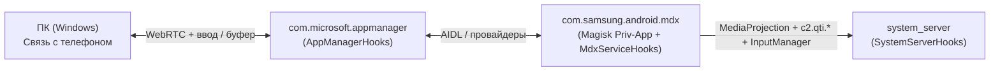

<div align="center">

# 📱 Phone Link AOSP Port

**Полный функционал Samsung «Связь с Windows» (*Link to Windows*) для root-устройств на чистом AOSP (Android 16).**

[](README.md)
[](README.ru.md)

[](https://github.com/Fleshoo/phonelink-aosp-module/releases/latest)
[-3ddc84?style=flat-square&logo=android&logoColor=white)](#требования)
[-ff6900?style=flat-square&logo=xiaomi&logoColor=white)](#требования)
[](#сборка-и-тесты)

[**Скачать последний релиз**](https://github.com/Fleshoo/phonelink-aosp-module/releases/latest)

</div>

---

## Возможности

- **«Экран телефона» (Phone Screen)** — трансляция экрана на ПК с Windows без прошивки One UI и без повторных системных запросов `MediaProjection`.
- **Аппаратное кодирование** — перенаправление видеопотока на кодеки Qualcomm `c2.qti.avc.encoder` / `c2.qti.hevc.encoder` с мгновенным IDR-кадром при старте.
- **Управление и буфер обмена** — мышь, клавиатура (`/dev/uinput`), кнопки «Назад» / «Домой» и синхронизация буфера обмена.
- **Стабильность на AOSP** — отключён несовместимый One UI `BlackScreen` (чёрный квадрат и краш `.spr`), исправлен краш MDX при остановке трансляции с телефона.

> [!NOTE]
> Проверено на **Xiaomi Mi 9 (`cepheus`)**, прошивка **Project Infinity X (Android 16 / SDK 36)**. Подойдёт и для других AOSP Android 16 с root на базе Qualcomm; на других версиях Android или SoC (MediaTek/Exynos/Tensor) могут потребоваться правки хуков или кодеков.

---

## Требования

- **ОС:** Android 16 (SDK 36) AOSP / кастомная прошивка
- **Root и хуки:** Magisk v26+ (или KernelSU / APatch с Zygisk) + **LSPosed**
- **Приложения:** **Связь с Windows** (`com.microsoft.appmanager`) на Android + **Связь с телефоном** на Windows 10/11

---

## Установка

1. **Удалите ранее установленную пользовательскую версию MDX (если была):**
   ```bash
   adb shell pm uninstall com.samsung.android.mdx
   ```
2. **Скачайте [`PhoneLinkMagisk-v2.1.0.zip`](https://github.com/Fleshoo/phonelink-aosp-module/releases/latest) и [`PhoneLinkXposed.apk`](https://github.com/Fleshoo/phonelink-aosp-module/releases/latest) из Releases.**
3. **Установите `PhoneLinkMagisk-v2.1.0.zip`** в Magisk / KernelSU Manager (*Модули → Установить из хранилища*). Пока не перезагружайте.
4. **Установите `PhoneLinkXposed.apk`** (`adb install -r PhoneLinkXposed.apk`), откройте **LSPosed Manager → Модули → Samsung Link to Windows Port**, включите модуль и выберите **все 3 области (scopes)**:
   - `android` (Система Android / System Framework)
   - `com.microsoft.appmanager` (Связь с Windows)
   - `com.samsung.android.mdx` (Служба «Связь с Windows»)
5. **Перезагрузите телефон** и подключите ПК в приложении **Связь с Windows**.

---

## Управление с ПК

| Ввод на ПК | Действие на Android |
| :--- | :--- |
| **ЛКМ / Свайп / Колёсико** | Нажатие / Свайп / Скролл на виртуальном экране |
| **ПКМ (правая кнопка)** | **Назад** (`KEYCODE_BACK`) |
| **СКМ (нажатие на колесо)** | **Домой** (`KEYCODE_HOME`) |
| **Клавиатура / Ctrl+C, Ctrl+V** | Аппаратный ввод текста (`/dev/uinput`) и буфер обмена |

---

## Архитектура



<details>
<summary><b>Модули исходников, диагностика и сборка</b></summary>

### Модули
- [`AppManagerHooks.java`](lsposed_module/app/src/main/java/me/phonelink/xposed/hooks/AppManagerHooks.java) — спуфинг `SM-G998B`, `SemFloatingFeature`, автоподтверждение прав, отключение `BlackScreen`
- [`MdxServiceHooks.java`](lsposed_module/app/src/main/java/me/phonelink/xposed/hooks/MdxServiceHooks.java) — мост `VirtualDisplay` / `MediaProjection`, фиксы `WindowContext` / `.spr`, безопасная отвязка `AppExecutionContainerService`
- [`SystemServerHooks.java`](lsposed_module/app/src/main/java/me/phonelink/xposed/hooks/SystemServerHooks.java) — выдача токена `MediaProjection` без диалога и `O(1)` кэш UID для `INJECT_EVENTS`
- [`InputInjectionHooks.java`](lsposed_module/app/src/main/java/me/phonelink/xposed/hooks/InputInjectionHooks.java) и [`VideoCodecHooks.java`](lsposed_module/app/src/main/java/me/phonelink/xposed/hooks/VideoCodecHooks.java) — ввод на целевой дисплей, кнопки Назад/Домой, кодеки `c2.qti.*`
- [`magisk_module/`](magisk_module/) — оверлей `/system/priv-app/LinkToWindowsService`, XML-разрешения, права на `/dev/uinput`

### Диагностика
- **Лог старта Magisk:** `adb shell su -c "cat /data/local/tmp/phonelink_service.log"`
- **Логи хуков:** `adb logcat -s PhoneLinkInit PhoneLink-SystemServerHooks PhoneLink-InputInjectionHooks PhoneLink-VideoCodec PhoneLink-MdxService PhoneLink-AppManager`
- **Нет кнопки экрана или просит разрешение снова:** проверьте все 3 области в LSPosed (`android`, `com.microsoft.appmanager`, `com.samsung.android.mdx`) и перезагрузитесь.
- **Нет видео на другом SoC (не Qualcomm):** поправьте имена энкодеров в [`VideoCodecHooks.java`](lsposed_module/app/src/main/java/me/phonelink/xposed/hooks/VideoCodecHooks.java).

### Сборка и тесты
Требуются **Python 3.10+** и **JDK 17+**. Перед сборкой Magisk ZIP поместите `LinkToWindowsService.apk` в `magisk_module/system/priv-app/LinkToWindowsService/`.

```bash
python build.py --test                  # Собрать Magisk ZIP + LSPosed APK + SHA256SUMS.txt и прогнать 349 тестов
python lsposed_module/build_lsposed.py  # Собрать только LSPosed APK
python tests/test_runner.py             # Запустить E2E-тесты (349 тестов / 5 уровней)
```

</details>
