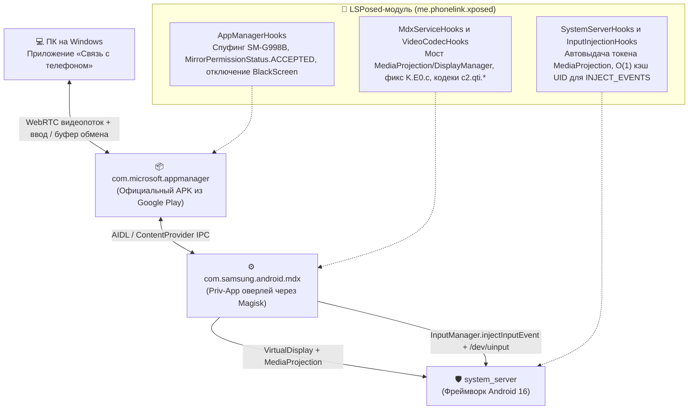

<div align="center">

# 📱 Phone Link AOSP Port (Magisk + LSPosed)

**Порт эксклюзивных функций Microsoft «Связь с Windows» (*Link to Windows*) для root-устройств на чистом AOSP (Android 16): трансляция экрана телефона на ПК, аппаратное кодирование видео и двустороннее управление мышью и клавиатурой.**

[](README.md)
[](README.ru.md)

[-3DDC84?style=flat-square&logo=android&logoColor=white)](#совместимость-и-требования)
[-FF6900?style=flat-square&logo=xiaomi&logoColor=white)](#совместимость-и-требования)
[](#совместимость-и-требования)
[](#архитектура)
[](#автотесты)
[](#сборка-из-исходников)

</div>

---

## ✨ О проекте

Модуль позволяет запустить официальное приложение **Microsoft «Связь с Windows»** (`com.microsoft.appmanager`) с полным функционалом уровня устройств Samsung на **AOSP / кастомных прошивках** без модификации системного раздела:

- **«Экран телефона» (Phone Screen)** — трансляция экрана через `VirtualDisplay` + `MediaProjection` без постоянных системных диалогов.
- **Аппаратное сжатие видео** — перенаправление энкодеров Samsung на аппаратные кодеки Qualcomm (`c2.qti.avc.encoder` / `c2.qti.hevc.encoder`).
- **Удалённое управление** — клики, свайпы, клавиатура и кнопки «Назад» / «Домой» с ПК.
- **Исправления совместимости AOSP** — обход проверок One UI, подпись пакетов, безопасная заглушка несовместимого `BlackScreen` и `.spr`-ресурсов.

> [!NOTE]
> Разработано и протестировано на **Xiaomi Mi 9 (`cepheus`)** с прошивкой **AOSP Project Infinity X (Android 16 / SDK 36)**. Модуль подходит и для других root-телефонов на AOSP Android 16, однако на других версиях Android (13–15) или других процессорах (MediaTek, Exynos, Tensor) могут потребоваться правки системных хуков или имён видеокодеков.

---

## 🏗️ Архитектура



### Основные компоненты

| Компонент | Назначение | Файлы |
| :--- | :--- | :--- |
| **Спуфинг и разрешения** | Подменяет `Build.MANUFACTURER = "samsung"` (`SM-G998B`) только для целевых процессов, эмулирует `SemFloatingFeature`, возвращает `MirrorPermissionStatus.ACCEPTED`, отключает `BlackScreen` | [`AppManagerHooks.java`](lsposed_module/app/src/main/java/me/phonelink/xposed/hooks/AppManagerHooks.java) |
| **Мост для сервиса MDX** | Связывает `W0.t.createVirtualDisplay` и `W0.p` с AOSP `DisplayManager` / `MediaProjection`, заглушает вызовы `SemWindowManager` / `RemoteAppModeManager`, защищает от крашей One UI `BlackScreen` и `.spr` | [`MdxServiceHooks.java`](lsposed_module/app/src/main/java/me/phonelink/xposed/hooks/MdxServiceHooks.java) |
| **Обход проверок `system_server`** | Автоматически выдаёт токен `MediaProjection` без диалогового окна и кэширует привилегированные UID за `O(1)` для `INJECT_EVENTS` | [`SystemServerHooks.java`](lsposed_module/app/src/main/java/me/phonelink/xposed/hooks/SystemServerHooks.java) |
| **Ввод и видеокодеки** | Пробрасывает `SemInputInjector` в `InputManager`, маппит ПКМ → **Назад** и СКМ → **Домой**, перенаправляет кодеки на `c2.qti.*` | [`InputInjectionHooks.java`](lsposed_module/app/src/main/java/me/phonelink/xposed/hooks/InputInjectionHooks.java), [`VideoCodecHooks.java`](lsposed_module/app/src/main/java/me/phonelink/xposed/hooks/VideoCodecHooks.java) |
| **Magisk-модуль** | Ставит `LinkToWindowsService` в `/system/priv-app/`, выдаёт `privapp-permissions` и исключения Doze, настраивает `/dev/uinput` и SELinux | [`magisk_module/`](magisk_module/) |

---

## 📋 Совместимость и требования

- **ОС**: Android 16 (SDK 36) AOSP / custom ROM *(проверено на Project Infinity X)*
- **Root**: Magisk v26.0+ или KernelSU / APatch с включённым **Zygisk**
- **Фреймворк**: **LSPosed** (Zygisk v1.9.2+ или актуальный форк Zygisk Next)
- **Процессор**: протестировано на **Qualcomm Snapdragon 855** (`c2.qti.avc.encoder` / `c2.qti.hevc.encoder`)
- **Приложения**:
  - На телефоне: **Связь с Windows** (`com.microsoft.appmanager`) из Google Play
  - На ПК: **Связь с телефоном** (*Phone Link*) для Windows 10 / 11

> [!IMPORTANT]
> Проприетарные APK (`LinkToWindowsService.apk`, `com.microsoft.appmanager`) не включены в git-репозиторий (добавлены в `.gitignore`). Для самостоятельной сборки Magisk-архива поместите `LinkToWindowsService.apk` в `magisk_module/system/priv-app/LinkToWindowsService/` или используйте готовые файлы из раздела **Releases**.

---

## 🚀 Установка

1. **Удалите старую пользовательскую версию MDX (если была установлена):**
   ```bash
   adb shell pm uninstall com.samsung.android.mdx
   ```
2. **Прошейте Magisk-модуль:**
   - Скопируйте `PhoneLinkMagisk-v2.0.0.zip` на телефон и установите через **Magisk / KernelSU Manager → Модули → Установить из хранилища**.
   - **Пока не перезагружайте устройство.**
3. **Установите и включите LSPosed-модуль:**
   ```bash
   adb install -r PhoneLinkXposed.apk
   ```
   Откройте **LSPosed Manager → Модули → Samsung Link to Windows Port (`me.phonelink.xposed`)**, включите модуль и отметьте **все 3 области (scopes)**:
   - [x] **Система Android / System Framework** (`android`)
   - [x] **Связь с Windows** (`com.microsoft.appmanager`)
   - [x] **Служба «Связь с Windows»** (`com.samsung.android.mdx`)
4. **Перезагрузите телефон** и выполните сопряжение с ПК через приложение **Связь с Windows** (`com.microsoft.appmanager`).

---

## 🖱️ Управление с ПК

| Действие на ПК | Действие на Android | Реализация |
| :--- | :--- | :--- |
| **ЛКМ / Перетаскивание** | Нажатие / Свайп / Скролл | AOSP `InputManager.injectInputEvent` с указанием ID дисплея |
| **ПКМ (правая кнопка)** | **Назад** (`KEYCODE_BACK`) | Трансляция состояния кнопок в `InputInjectionHooks` |
| **СКМ (колёсико)** | **Домой** (`KEYCODE_HOME`) | Трансляция состояния кнопок в `InputInjectionHooks` |
| **Ввод с клавиатуры** | Печать текста и навигация | Аппаратный мост через `/dev/uinput` (`0666`) |
| **Ctrl + C / Ctrl + V** | Синхронизация буфера обмена | Двусторонний обмен через `ClipboardBridge` |

---

## 🛠️ Диагностика и решение проблем

<details>
<summary><b>Команды для проверки логов и частые проблемы</b></summary>

- **Лог загрузочного скрипта Magisk:**
  ```bash
  adb shell su -c "cat /data/local/tmp/phonelink_service.log"
  ```
- **Живой фильтр логов всех хуков модуля:**
  ```bash
  adb logcat -s PhoneLinkInit PhoneLink-SystemServerHooks PhoneLink-InputInjectionHooks PhoneLink-VideoCodec PhoneLink-MdxService PhoneLink-AppManager
  ```
- **Проверка прав на `/dev/uinput` и `/dev/uhid`:**
  ```bash
  adb shell ls -la /dev/uinput /dev/uhid
  ```
- **Нет кнопки «Экран телефона» или постоянно просит разрешение на запись экрана:** проверьте, что в LSPosed отмечены все 3 области (`android`, `com.microsoft.appmanager`, `com.samsung.android.mdx`) и выполнена перезагрузка.
- **Нет изображения на другом процессоре (не Qualcomm):** измените имена аппаратных энкодеров в [`VideoCodecHooks.java`](lsposed_module/app/src/main/java/me/phonelink/xposed/hooks/VideoCodecHooks.java).

</details>

---

## 🧪 Автотесты

В проект входит E2E-набор из **349 тестов в 5 уровнях** и стресс-тесты скомпилированного Java-байткода:

```bash
# Запустить все тесты
python tests/test_runner.py

# Запуск по уровням
python tests/test_runner.py --tier 1   # Покрытие функций (74 теста)
python tests/test_runner.py --tier 2   # Граничные случаи и нагрузка (184 теста)
python tests/test_runner.py --tier 3   # Межмодульные сценарии (14 тестов)
python tests/test_runner.py --tier 4   # Реальные сценарии работы (8 тестов)
python tests/test_runner.py --tier 5   # Adversarial-тесты и JVM-бенчмарки (69 тестов)
```

---

## 🔨 Сборка из исходников

Требуются **Python 3.10+** и **JDK 17+** (необходимые Android/Xposed build-инструменты скрипт `build_lsposed.py` скачает автоматически).

```bash
# Полная сборка Magisk ZIP + LSPosed APK + SHA256SUMS.txt
python build.py

# Сборка с запуском всех автотестов
python build.py --test

# Сборка только LSPosed APK
python lsposed_module/build_lsposed.py
```

Готовые файлы сохраняются в папку `build/` (`PhoneLinkMagisk-v2.0.0.zip`, `PhoneLinkXposed.apk`, `SHA256SUMS.txt`).
